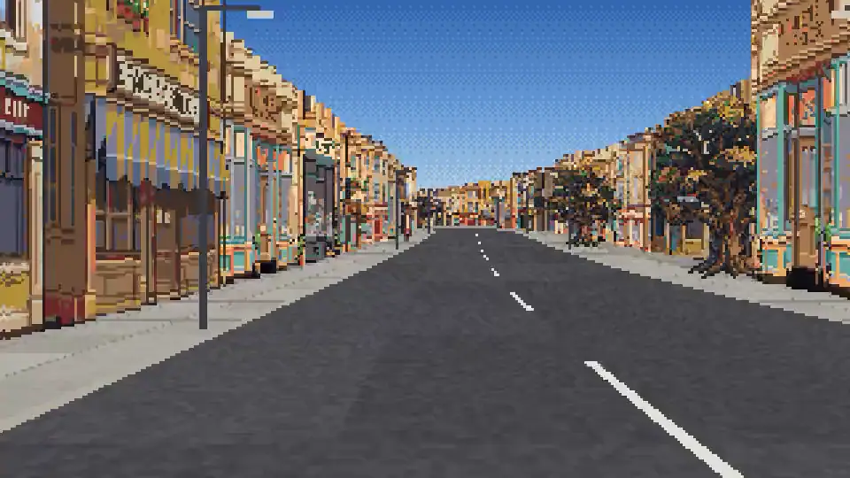
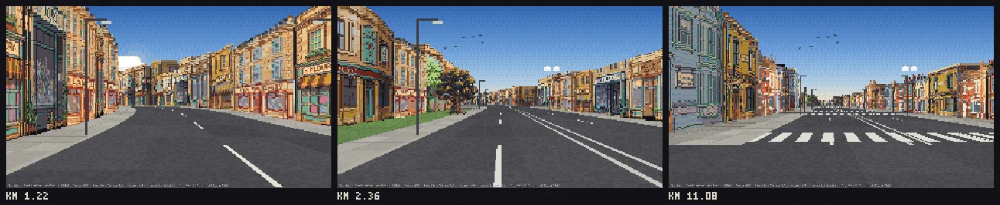
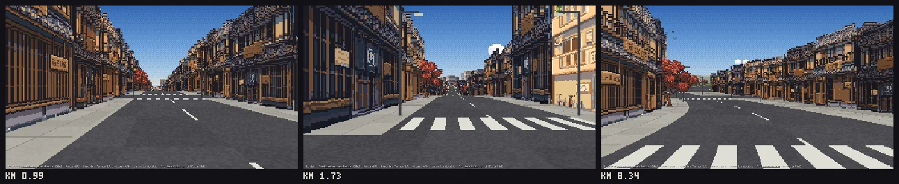

# Pixel Path

A Claude Code skill that turns any two places into a pixel-art fly-through of the real road. Ask Claude for "a pixel
path from Bath to Bristol" and it:

- routes the trip
- bakes the real buildings, land cover, landmarks, hills and horizon along it from OpenStreetMap and elevation data
- generates scenery art for the region with [RetroDiffusion](https://www.retrodiffusion.ai?ref=YBQJM823) (affiliate
  link)
- checks its own work with screenshots
- hands you a page where you zoom along the route. Scroll to go faster, slower or backwards.



*Bath, England: real streets from OpenStreetMap, art generated with the `moderate` kit.*

## What it is for

A first-person, pixel-art view of any real road, built from the real map. Useful wherever you want a real place or route
on screen:

- **Games:** a real road as a level for a driving, racing, idle or endless-runner game, instead of a made-up one.
- **Showing a journey:** a commute, a delivery round, a marathon or cycling stage, a road trip you took, a move between cities.
- **Content:** trip recaps, travel posts, video intros, stream backgrounds and lo-fi loops.
- **Places and history:** Route 66, a pilgrimage route, the road in a news story, a preview of a neighbourhood.
- **Learning:** a commented pseudo-3D renderer and an OpenStreetMap bake pipeline to read or build on.

## What you get

A folder with an `index.html`. Open it through any static web server and you are moving down the real road:

- **Buildings on their real footprints.** Every building that faces the road is a block on its real line, with the
  kind of picture its type and height call for. A long frontage becomes a row of different buildings, and cracks and
  short lots are closed.
- **More of the real place.** A second row of buildings shows across squares and car parks, tall buildings make a
  skyline, and landmarks stand at their real places.
- **The real ground.** Fields, forest, water, parking lots and sidewalks are drawn per pixel from the map. The hills
  are real, and so is the horizon, marched over a 61 × 61 km height grid with the Earth's curvature.
- **Signs drawn by code,** so the names are exact: town names, distances, street names, brown landmark signs and
  railway crossings.
- **No interface** apart from a small credits line:
  - Scroll (or drag on a touch screen) to speed up from a crawl to very fast. Keep going the other way to slow down
    and reverse.
  - The arrow keys do the same, and Space pauses.
  - `I` shows where you are and `M` shows a small map.

## Three levels of detail

Before anything slow happens, the first step prints an estimate for your route, and the skill asks you to choose.
Only the art costs money: $0.18 a picture at RetroDiffusion's `rd_pro__default` (October 2026). Cost depends on the
number of regions (distinct looks along the route), not on distance.

| level | pictures per region | 1 region | 2 regions | what you get |
| --- | --- | --- | --- | --- |
| placeholders | 0 | $0 | $0 | code-drawn stand-ins for every picture |
| **sparse** | 4 | $0.72 | $1.44 | three kinds of building and a tree. Every lot is still filled; mirrored and tinted copies stretch the pictures. |
| **moderate** | about 14, + 4 landmarks | $3.24 | $5.76 | about ten buildings across the main kinds, two trees, a shrub, a street prop, the four best-known landmarks |
| **detailed** | about 26, + 10 landmarks | $6.48 | $11.16 | up to six variants of each kind of building, three trees, two shrubs, three street props, ten landmarks |

The levels are nested, so moving up a level only pays for the new pictures. The exact quote is free and comes after
the bake. Allow about 25% on top for re-rolls: in testing, 10% (Bath) to 34% (Manhattan) of pictures came back cut off
or on a background. The cleanup dropped them, and the self-check re-rolled them within the budget.

### Examples

Bath to Bristol at **moderate** (two regions, Georgian Bath, then Victorian Keynsham and Bristol, 32 pictures, $5.76):



Kyoto Station to Kinkaku-ji, Japan, at **sparse** (one region, four pictures, $0.72):



Both runs passed the full self-check, including the sweep: 627 and 345 moving frames, with no sky through or between
buildings. The estimate printed after routing matched the exact quote in every test run.

## Install

**As a plugin.** In Claude Code:

```
/plugin marketplace add jonwheatley/pixel-path
/plugin install pixel-path@pixel-path
```

**By hand.** Copy this folder into your skills folder, so that the skill is at
`~/.claude/skills/pixel-path/SKILL.md`. For a single project, use `.claude/skills/pixel-path/` inside it.

Then ask Claude: "make me a pixel path from Paris to Versailles".

## Requirements and setup

- **Node 18 or newer.** No npm packages are needed to build a route.
- **A RetroDiffusion account with credit, for real art:** <https://www.retrodiffusion.ai?ref=YBQJM823>. **This is an
  affiliate link** (the author of this skill gets a referral).
  - Create an API key and set it in your own terminal with `export RETRODIFFUSION_API_KEY=...`.
  - On a Mac you can store it in the Keychain instead: `security add-generic-password -s pixel-path -a retrodiffusion -w`.
  - Never paste the key into a chat. The skill never asks for it and never prints it.
  - Without an account, placeholders cost nothing.
- **For the self-check's screenshots:** Node 20 or newer with Playwright and Chromium (`npm i -D playwright && npx
  playwright install chromium`). Without them, the layout and art checks still run.
- **Network access while baking** to Nominatim, OSRM, Overpass, AWS Terrain Tiles and Wikidata. Baking takes about 20
  to 60 seconds per 10 km.

## How it checks itself

The skill doesn't call a route done when the code runs. It calls it done when the pictures pass:

1. **Every building is a solid.** Each building is laid along its real line and always gets a shaded end wall, so it
   never reads as a flat card. A neighbour that joins it paints over the part it covers.
   - Cracks under 3 m are closed.
   - In a dense street, a building mapped far back is pulled up to the sidewalk.
   - A backing building stands behind every gap in a built-up row.
   - A second row of real buildings shows across squares and car parks.
2. **Cleanup.** Each picture is cleaned and its backdrop flood-filled away. Holes in facades are filled, including a
   roof-to-ground gap between two houses drawn in one picture. Pictures that still carry a background, painted sky, a
   cut-off edge or a sliver are dropped. A contact sheet of every picture is written for Claude to look at.
3. **Layout check.** The whole route is laid out exactly as the page will draw it, checking for gaps in street walls
   and for a building with the same picture as its neighbour.
4. **The sweep.** Every 75 m of built-up road, the camera moves and looks straight ahead and 30° to each side. The sky
   is painted magenta and every building is drawn into a mask, and it counts:
   - sky seen through a building
   - slits of sky between two parts of the same street wall that reach down to the ground

   The 20 worst frames are written side by side with the problem marked.
5. **Review.** Claude is told to look at the worst frames and the samples and keep fixing until the sweep is clean.

## Credits and licences

The page shows a credits line that must stay visible wherever a fly-through is shown.

- **Map data © OpenStreetMap contributors**, under the
  [Open Database Licence](https://www.openstreetmap.org/copyright). A route's `data/` folder is a derived database: if
  you share it publicly, it stays under the ODbL, with credit.
- **Routing:** [OSRM](https://project-osrm.org/), from OpenStreetMap data. The public servers are for light use.
- **Geocoding:** [Nominatim](https://nominatim.org/), under the OSM Foundation's usage policy.
- **Elevation:** [Terrain Tiles](https://registry.opendata.aws/terrain-tiles/) (Mapzen/Tilezen on AWS Open Data), from
  SRTM, GMTED2010, ETOPO1, NED and others
  ([attribution](https://github.com/tilezen/joerd/blob/master/docs/attribution.md)).
- **Landmarks:** [Wikidata](https://www.wikidata.org/) (CC0).
- **Art:** generated by you with [RetroDiffusion](https://www.retrodiffusion.ai?ref=YBQJM823) (affiliate link), under
  RetroDiffusion's terms of service. The pictures in this README were generated with this skill.
- **Code:** MIT (see `LICENSE`), by Jon Wheatley. The road projection is the classic arcade technique (see Lou's Pseudo
  3D Page and Jake Gordon's Javascript Racer).

## Known limits

- **OpenStreetMap coverage decides the street.** Where buildings aren't mapped, plausible ones are filled in by land
  use (houses on lawns, shops on paved land, a row behind in dense towns). Heights are often missing and are guessed
  from building type.
- **Open spaces look open.** Squares, junctions, car parks and parks read as wide paving or grass with buildings across
  them, because that is what is there. Some frames in a city centre show more paving than you would expect.
- **The art is the model's.** The cleanup catches backgrounds, painted sky, cut-off pictures and slivers, but not
  everything: a building drawn at an angle, for example. Claude is told to look at every picture and re-roll bad ones,
  at the cost of a picture each.
- **One look per region.** Every town in a region uses the same kit, and long streets show the same pictures again
  further along. Split a long route into more regions for more variety, at more cost.
- **Landmarks are pictures, not models.** A landmark faces the road and does not turn as you pass. You need to
  describe what it looks like (the model does not know buildings by name), and a landmark just behind the start point
  is not shown.
- **Overpass is the slow, flaky step.** The public servers time out under load. The bake retries across mirrors and
  resumes, but a long route can take an hour on a bad day.
- **Driving routes only, in one afternoon light.** Routes come from OSRM's car profile. There is no traffic, no people
  and no weather.
