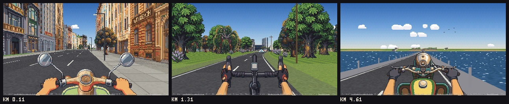
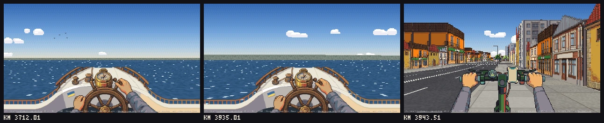

# Піксельна Україна (Pixel Ukraine)

Claude mapped a full loop round Ukraine for a multiplayer pixel-art ride: 5,846 km from Kyiv back to Kyiv on real
roads, sampled every 40 m from OpenStreetMap, with 233 km by ship from Izmail to Odesa. The hills on the horizon are
real as well: every 10 km of road has its own 61 × 61 km height grid, 585 of them in all. The game:

- rides the real road through Chernihiv, Sumy, Kharkiv, Dnipro, Luhansk, Donetsk, Mariupol, Kerch, Yalta, Sevastopol,
  Kherson, Odesa, Izmail (then back to Odesa by ship), Vinnytsia, Kamianets-Podilskyi, Chernivtsi, Uzhhorod, Lviv and
  Lutsk
- stands the buildings on their real OpenStreetMap footprints, and puts the landmarks and tree belts where they really are
- draws the road in 20 looks, five of them in Kyiv, with 441 pictures in all. 247 are from RetroDiffusion, 193 from
  FLUX.2 [klein] (free) and one was drawn by code. The paid art cost $62.40, counting the two Kyiv test runs before the loop
- puts you on a scooter, a motorbike, an e-scooter or a bicycle, or on foot, with 77 cars in the traffic
- puts everyone who is riding at the same time on the same road.

https://github.com/user-attachments/assets/891a6749-84cc-4b32-a48a-880e33fa00ce

*On foot on Khreshchatyk in Kyiv, then faster at every cut: Chernihiv, Sumy, Kharkiv, the Dnipro bridge, Donetsk and
Mariupol in Mad Max mode, the Azov coast, Yalta, Sevastopol, Kherson, Odesa, the Black Sea by ship, Vinnytsia,
Kamianets-Podilskyi, the Carpathians, Lviv, Lutsk, and back into Kyiv at 7,000 km/h. Then the map draws the whole
5,846 km loop. Some shots are from a car cockpit that the game no longer offers. Turn the sound on: the music is a song
from a Radio ROKS broadcast, cut on its beat, over the game's own sounds.* The file is
[docs/pixel-ukraine.mp4](docs/pixel-ukraine.mp4) (18 seconds).

Play it at https://ukraine-ride.kozak-74d.workers.dev. The game's text is in Ukrainian.

It is built on [Pixel Path](https://github.com/jonwheatley/pixel-path) by Jon Wheatley, and it started with
[his post](https://x.com/jonpaul/status/2109693904136405364) about a coast-to-coast route across the USA. Jon's README
for the engine and the skill is in [docs/pixel-path.md](docs/pixel-path.md).

## What it is for

A first-person ride round the whole of Ukraine, built from the real map, that anyone can open in a browser and ride
with other people:

- **Riding together:** open the link and you are on the road with whoever else is riding. Send a link with `?room=...`
  and only the people who have it ride with you.
- **Seeing the country:** the real streets of Kyiv, Odesa and Lviv, the steppe, the Azov and Black Sea coasts, Crimea
  and the Carpathians, with each region's own buildings and the radio of the city you are in.
- **Content:** trip videos, stream backgrounds and city postcards. The video above was cut from the game.
- **Your own country:** the bake runs on any OpenStreetMap extract. Change two URLs in `docker-compose.yml` and bake
  your own loop.
- **Learning:** a commented pseudo-3D renderer, an OpenStreetMap bake pipeline and multiplayer rooms on Cloudflare
  Durable Objects, all in plain JavaScript with no dependencies.

## What you get

A web page that runs from any static server, with a small Node relay for multiplayer, or on a free Cloudflare account:

- **Buildings on their real footprints,** as in Pixel Path: every building that faces the road stands on its real
  line, with a picture for its type and height, in the look of its region. Kyiv alone has five kits.
- **The real ground.** Fields, forest, water and pavements come from the map. Tree belts along the road
  come from ESA WorldCover, the hills from the height data, and the horizon is marched over the 61 × 61 km height grid.
- **Vehicles.** A scooter, a motorbike, an e-scooter or a bicycle, each with its own first-person cockpit and
  engine sound, or you can walk. On the sea leg you stand at a ship's wheel.
- **Other riders.** Name tags, a riders panel (`P`) and a chat. The open world is split into rooms by 500 km sections
  of the loop, up to 150 riders a room, and you move from room to room as you ride.
- **Mad Max mode (`X`).** Orcs on the road in Kharkiv, Donbas, Zaporizhzhia, Kherson and Crimea, rockets in the sky
  everywhere, an interceptor you launch with a click or `F`, and evacuation buses picking people up.
- **Day and night** from your clock, or `?time=day`, `dusk`, `night` or `dawn` in the address.
- **Radio:** 15 national stations and 53 city stations in 25 cities. `A` lets the radio follow the city you are in.
- **The big map (`O`):** the whole loop with a postcard of each of the 20 cities. Click it to jump there, or open the
  same spot in Google Maps or Street View.
- **Rush hour in Kyiv:** jams by the hour, on the minimap and on the road.
- **The city vote,** if you turn it on: players donate to a Monobank jar and the comment names a city for the route.

## Three levels of detail

The engine's levels are unchanged. Before anything slow happens, the first step prints an estimate for your route, and
the skill asks you to choose. Only the art costs money: $0.18 a picture at RetroDiffusion's `rd_pro__default`
(October 2026). Cost depends on the number of regions (distinct looks along the route), not on distance.

| level | pictures per region | 1 region | 2 regions | what you get |
| --- | --- | --- | --- | --- |
| placeholders | 0 | $0 | $0 | code-drawn stand-ins for every picture |
| **sparse** | 4 | $0.72 | $1.44 | three kinds of building and a tree. Every lot is still filled; mirrored and tinted copies stretch the pictures. |
| **moderate** | about 14, + 4 landmarks | $3.24 | $5.76 | about ten buildings across the main kinds, two trees, a shrub, a street prop, the four best-known landmarks |
| **detailed** | about 26, + 10 landmarks | $6.48 | $11.16 | up to six variants of each kind of building, three trees, two shrubs, three street props, ten landmarks |

The levels are nested, so moving up a level only pays for the new pictures.

This loop uses `moderate` in all 20 looks, with more pictures than the level asks for: 22 in most regions and 42 in the
Carpathians. RetroDiffusion drew Kyiv, Polissia, Slobozhanshchyna, Donbas, the Azov coast, the Tavria steppe, most of
Kerch, the Carpathians, and the cockpits, riders and Mad Max sprites. FLUX.2 [klein] drew Kharkiv, the south coast of
Crimea, the Dnipro steppe, Odesa, Bessarabia, Podillia, Bukovyna, Halychyna and Volyn, and the 20 city cards, on
Cloudflare Workers AI's free plan. Free art is also how new pictures come in: see [CONTRIBUTING.md](CONTRIBUTING.md).

### Examples

Kyiv, from Khreshchatyk through the parks on the Dnipro slopes to the Metro bridge, on the scooter, the bicycle and the
motorbike (five Kyiv kits, 72 RetroDiffusion pictures):



Izmail to Odesa by ship, the 233 km sea leg, then ashore in Odesa on the e-scooter (the Podillia kit, 22 FLUX.2 [klein]
pictures, $0):



The frames come from a fresh build of this repo's trip, in a headless browser, single-player.

## Install

### Play it from this repo

You need Node.js 20 or newer and nothing else: there are no packages to install.

```sh
git clone https://github.com/k1p1l0/pixel-ukraine.git
cd pixel-ukraine
node scripts/viewer.mjs --trip trips/ukraine-loop --serve 8080
```

Open http://127.0.0.1:8080/?mp=0. `viewer.mjs` copies the page, the renderer, the fonts and the sounds from
`templates/` into the trip folder, then serves the folder. `?mp=0` means you ride alone; without it the page keeps
trying to reach a multiplayer server that this static server does not have.

Controls:

| key | what it does |
| --- | --- |
| W or Up (hold) | speed up |
| S or Down (hold) | brake, then reverse |
| Left, Right, scroll, drag | slower or faster |
| Space | pause |
| V | change vehicle |
| R / A | next radio station / let the radio follow the city |
| N | sound on or off |
| O | the big map |
| P | the riders panel |
| H | hide everything but the road |
| I | where you are |
| M | the HUD on or off |
| X | Mad Max mode |
| F or a click | launch an interceptor (Mad Max mode) |

Useful URL options: `km=1200` starts at that kilometre, `vehicle=moto|bike|samokat|scooter|none` picks the vehicle,
`time=day|dusk|night|dawn` sets the light, `traffic=0` turns off the cars, `jam=1` forces rush hour, `ph=0` turns off
analytics if the build has them.

### Multiplayer on your own machine

`scripts/mp/relay.mjs` is a small multiplayer server with no dependencies. It can serve the trip as well, so one
process runs the whole game:

```sh
node scripts/viewer.mjs --trip trips/ukraine-loop
node scripts/mp/relay.mjs --port 8787 --static trips/ukraine-loop
```

Open http://127.0.0.1:8787/ in two browser windows. Everyone who opens the page without a room joins the open world, and
`?room=friends` is a private room for the people who have that link. Other devices on your network can join through
your computer's address, for example http://192.168.1.20:8787/. Add `--max 4` to test what happens when a room is full.

### Deploy your own copy to Cloudflare

The game runs on a free Cloudflare account. The pages and pictures are Worker static assets, and each room is a
Durable Object (SQLite storage, which the free plan includes).

```sh
node scripts/viewer.mjs --trip trips/ukraine-loop
cp deploy/wrangler.toml.example deploy/wrangler.toml   # set name = "your-worker-name"
npx --yes wrangler@4.77.0 login
npx --yes wrangler@4.77.0 deploy --config deploy/wrangler.toml
```

Wrangler prints the address, `https://<name>.<your-subdomain>.workers.dev`. `deploy/wrangler.toml` is ignored by git,
so your settings stay out of the repo. The config's comments explain the optional city vote. It needs a Monobank jar
and a read-only Monobank token, and the token goes in as a Worker secret, never into the file. Once the vote runs,
add `"vote": true` to `trips/ukraine-loop/site.json` and build again: without it the start screen shows no vote panel.

Analytics are off unless you ask for them. To send anonymous events to your own PostHog project, put your project key
in `trips/ukraine-loop/site.json`, `{"posthog": "phc_..."}`, and build again. The page then loads PostHog through the
Worker's `/ph` proxy, keeps everything in memory only and never sends names or chat text. A `"support": "https://..."`
entry in the same file puts a donation link on the start screen.

### Bake a region

The baked map in `trips/ukraine-loop/data` comes from OpenStreetMap. To bake a new route, or to bake this one again with
fresh data, run your own Overpass server. The public servers queue and rate-limit long bakes.

```sh
docker compose up -d        # Overpass with the Ukraine extract from Geofabrik, on 127.0.0.1:12345
docker compose logs -f      # the first start imports the extract: wait until it says it is ready
```

Then route, bake and add the extras. Every step can be run again and picks up where it stopped:

```sh
node scripts/route.mjs --out trips/my-trip --from "Lviv, Ukraine" --to "Uzhhorod, Ukraine" --via "Mukachevo, Ukraine"
node scripts/bake.mjs  --trip trips/my-trip --overpass http://127.0.0.1:12345/api/interpreter
node scripts/lanes.mjs --trip trips/my-trip --overpass http://127.0.0.1:12345/api/interpreter
node scripts/green.mjs --trip trips/my-trip      # roadside tree belts from ESA WorldCover
node scripts/outline.mjs --trip trips/my-trip    # the country outline for the overview map
node scripts/land.mjs --trip trips/my-trip       # the coastline, so the sea stays sea on the map
```

For the pictures, plan the regions and subjects with `scripts/plan-art.mjs`, draw free stand-ins with
`scripts/placeholder-art.mjs`, then replace them with real art (see [CONTRIBUTING.md](CONTRIBUTING.md)) and clean it with
`scripts/clean.mjs`. [docs/pixel-path.md](docs/pixel-path.md) and [SKILL.md](SKILL.md) walk through every step and its
options. To bake another country, change the two Geofabrik URLs in `docker-compose.yml`.

### As a Claude Code skill

The repo is still a Pixel Path skill, so Claude can make a pixel path between any two places with it. In Claude Code:

```
/plugin marketplace add k1p1l0/pixel-ukraine
/plugin install pixel-ukraine@pixel-ukraine
```

Or copy this folder so that the skill is at `~/.claude/skills/pixel-ukraine/SKILL.md`. Then ask Claude: "make me a pixel
path from Lviv to Uzhhorod".

### What is in the repo

- `scripts/`: the bake pipeline, the art tools and the art check. `scripts/mp/` has the multiplayer room logic
  (`core.mjs`), the Node relay, the Cloudflare Worker and the city vote.
- `templates/`: the game page (`viewer.html`), the renderer (`road.js`), the roadside layout (`layout.js`), the sounds,
  the fonts and the palette.
- `trips/ukraine-loop/`: the route, the 585 baked map chunks of 10 km each, the art kit and the city cards.
  `art/SOURCES.json` says where every picture came from.
- `deploy/`: the Wrangler config for your own copy. `docker-compose.yml`: the local Overpass server.

## Requirements and setup

- **Node 20 or newer.** No npm packages are needed to play, host the relay or build a route.
- **To host it:** a free Cloudflare account. Wrangler 4.77.0 runs through `npx`, so you don't install it.
- **To bake:** Docker for the local Overpass server. The first start downloads the Geofabrik extract (about 0.9 GB) and
  needs an hour or two and about 10 GB of disk. The bake also needs network access to OSRM, Nominatim, AWS Terrain
  Tiles, Wikidata and ESA WorldCover.
- **For free art:** your own Cloudflare Workers AI account (the free plan gives 10,000 neurons a day, about 380
  FLUX.2 [klein] pictures), plus Python 3 and Pillow for `scripts/free-art.py`. [CONTRIBUTING.md](CONTRIBUTING.md) has
  the steps.
- **For paid art:** a RetroDiffusion account with credit, <https://www.retrodiffusion.ai>.
  - Create an API key and set it in your own terminal with `export RETRODIFFUSION_API_KEY=...`.
  - On a Mac you can store it in the Keychain instead: `security add-generic-password -s pixel-path -a retrodiffusion -w`.
  - Never paste the key into a chat. The skill never asks for it and never prints it.
- **For the self-check's screenshots:** Playwright and Chromium (`npm i -D playwright && npx playwright install
  chromium`). Without them, the layout and art checks still run.

## How it checks itself

The engine's self-check is Jon's, unchanged (`scripts/check.mjs`). It calls a route done when the pictures pass:

1. **Every building is a solid.** Each building is laid along its real line and always gets a shaded end wall, so it
   never reads as a flat card. Cracks under 3 m are closed, a backing building stands behind every gap in a built-up
   row, and a second row of real buildings shows across squares and car parks.
2. **Cleanup.** Each picture is cleaned and its backdrop flood-filled away. Pictures that still carry a background,
   painted sky, a cut-off edge or a sliver are dropped. A contact sheet of every picture is written for Claude to look at.
3. **Layout check.** The whole route is laid out exactly as the page will draw it, checking for gaps in street walls
   and for a building with the same picture as its neighbour.
4. **The sweep.** Every 75 m of built-up road, the camera looks straight ahead and 30° to each side, with the sky
   painted magenta, and counts sky seen through a building and slits of sky in a street wall. The worst frames are
   written side by side with the problem marked.
5. **Review.** Claude is told to look at the worst frames and the samples and keep fixing until the sweep is clean.

This repo adds three checks of its own:

6. **The art check.** `scripts/art-check.mjs` runs in CI on every pull request that changes a picture. A picture passes
   when it is an 8-bit RGBA PNG with hard alpha, no bigger than its plan size, at most 48 colours and 16 KB, with no
   colour over 80% of it and none of `clean.mjs`'s drop flags.
7. **The secrets scan.** gitleaks 8.30.1 scans every push and pull request, history included, for API keys, tokens and
   private keys.
8. **The room tests.** `scripts/mp/core-test.mjs`, `votes-test.mjs` and `rooms-test.mjs` test the room logic, the city
   vote and the open world's rooms with fake riders and a fake clock. Run them before a pull request.

The last full self-check of the loop (14 October 2026) swept 1,179 moving frames and found sky through or between
buildings in 26 of them, which are not fixed yet.

## Credits and licences

The page shows a credits line, and the game's landing page shows the map attributions. Both must stay visible wherever
the game is hosted. [NOTICE.md](NOTICE.md) has every attribution a copy must keep, and what is still being checked.

- **Map data © OpenStreetMap contributors**, under the
  [Open Database Licence](https://www.openstreetmap.org/copyright). The baked chunks in `trips/ukraine-loop/data/` and
  the place list in `scripts/mp/votes-extra.mjs` are a derived database: if you share them, they stay under the ODbL
  ([trips/ukraine-loop/data/LICENSE](trips/ukraine-loop/data/LICENSE)), with credit.
- **Routing:** [OSRM](https://project-osrm.org/), from OpenStreetMap data. The Izmail to Odesa leg is a hand-drawn line.
- **Geocoding, the country outline and the neighbours:** [Nominatim](https://nominatim.org/). **Oblast borders:**
  OpenStreetMap boundary ways from an Overpass server.
- **Elevation:** [Terrain Tiles](https://registry.opendata.aws/terrain-tiles/) (Mapzen/Tilezen on AWS Open Data), from
  SRTM, GMTED2010, ETOPO1, EU-DEM and others
  ([attribution](https://github.com/tilezen/joerd/blob/master/docs/attribution.md)).
- **Tree belts:** ESA WorldCover 10 m 2021 v200, CC BY 4.0. **Coastline:** Natural Earth, public domain.
- **Landmarks:** [Wikidata](https://www.wikidata.org/) (CC0).
- **Pictures:** CC BY 4.0, by Kyrylo Kozak, who wrote the prompts and chose the pictures: 247 from RetroDiffusion, 193
  from FLUX.2 [klein] 4B (Black Forest Labs, Apache 2.0) on Cloudflare Workers AI, and one drawn by code.
  `trips/ukraine-loop/art/SOURCES.json` lists the source of every picture. The video and frames in `docs/pixel-ukraine*`
  are recorded from the game, under the same licence, with the game's own sounds.
- **Sounds:** made with ElevenLabs sound effects, CC BY 4.0, by Kyrylo Kozak.
- **Radio list:** CC0. The broadcasts belong to the stations; the game only links to their streams.
- **Fonts:** Oswald, Roboto Condensed and Tiny5, under the SIL Open Font License 1.1.
- **Code:** MIT ([LICENSE](LICENSE)), by Jon Wheatley and Kyrylo Kozak. The road projection is the classic arcade
  technique (see Lou's Pseudo 3D Page and Jake Gordon's Javascript Racer).

## Known limits

- **OpenStreetMap coverage decides the street.** Where buildings aren't mapped, plausible ones are filled in by land
  use. Heights are often missing and are guessed from building type. Where a place has no Ukrainian name in
  OpenStreetMap, its sign shows the main name, and in the occupied areas that is often Russian.
- **Twenty looks for 5,846 km.** Every town in a region uses the same kit, so long stretches show the same pictures
  again. Kharkiv still has no buildings of its own.
- **The art is the model's.** The cleanup catches backgrounds, painted sky, cut-off pictures and slivers, but not
  everything. Six pictures were dropped after review, one landmark (`lm-Q111017791`) is still a stand-in, and
  `node scripts/art-check.mjs --trip trips/ukraine-loop --report` lists the pictures that fail the art check.
- **Landmarks are mostly signs.** Three landmarks have pictures and a fourth has a code-drawn stand-in. The others are
  signed by code at their real places.
- **The sea leg is drawn, not routed.** The ship follows a hand-drawn line down the Danube and along the coast, 233 km
  of open water.
- **No live traffic.** Rush-hour jams are made up from the clock, in Kyiv only. No live traffic service covered
  Ukrainian roads in October 2026.
- **The road is sampled every 40 m** on a route this long (the bake picks the step by length), and the sun is placed
  from each 10 km chunk's origin. There is no weather.
- **Overpass is the slow step.** Bake against your own server (`docker-compose.yml`); the public ones time out on a
  route this long.

[ROADMAP.md](ROADMAP.md) lists what is planned. To help, start with [CONTRIBUTING.md](CONTRIBUTING.md).
